  

 

  <i>oh, hello — come on in.</i>
    
  i'm <b>Eleven</b>. i use AI to build the things i wish existed: 
  soft interfaces, visual ideas, and small tools that make a day a little nicer.
    
  i'm not a genius developer, and i'm not pretending to be. 
  i think of this place as a garden. ideas go in as seeds, 
  and with enough prompts, patience and curiosity, some of them bloom.
    
  make yourself at home. wander around. nothing here bites.

 

## the garden

three kinds of things grow here

  

 

## how an idea grows

every single project here took this walk

  

  <i>most ideas spend a long time in the weather. that's okay — it's where the roots get strong.</i>

 

## this season

<table>
  <tr>
    <th align="left" width="50%">🌱&nbsp; growing</th>
    <th align="left" width="50%">🍂&nbsp; composting</th>
  </tr>
  <tr>
    <td valign="top">
      things i'm making more room for
        
      learning out loud, in public 
      shipping small, honest, slightly weird things 
      asking AI kinder, better questions 
      caring how things <i>feel</i>, not just how they work
        
    </td>
    <td valign="top">
      things i'm letting go of — they still feed the soil
        
      pretending to know everything 
      waiting until i "know enough" to start 
      comparing my day one to someone's year ten 
      building things nobody (including me) wanted
        
    </td>
  </tr>
</table>

 

## the shed

the tools i reach for most

   
  
    
  …and AI — part sketchbook, part co-pilot, part very patient teacher.

 

## rainfall

how often i've been out tending things lately

  

 

## pinned to the shed door

  

&nbsp;<b>a little more about growing with AI</b>&nbsp;(open me)

 

i build with AI, and i'm happy to say so.

it doesn't replace the taste, the choices, or the long evenings of *"hmm, no, not quite like that."*
it just means more of the ideas in my head get to leave it, and become something you can actually click on.

if you're just starting out too: hi. you're doing fine. plant something small.

 

  

  

