  

 

  <i>oh — hi. you found the garden.</i>

  i'm <b>Eleven</b>. 
  a while ago i noticed my head was full of ideas with nowhere to go — 
  little interfaces, half-dreamed tools, moods i wanted to see on a screen. 
  i couldn't build most of them on my own. so i started planting them anyway, 
  with AI as my watering can.

  some didn't make it. some are still sprouting. a few actually bloomed. 
  this is where all of them live.

  take your time. the path is a little crooked, but it's friendly.

 

## the garden

three beds, three kinds of seeds

  

  <i>i didn't plan these beds. i just kept noticing what i reached for when nobody was asking me to make anything.</i>

 

## how an idea grows

it's the same walk, every single time

  

  most ideas spend a long time out in the rain. 
  i used to think that meant i was doing it wrong. 
  now i think that's just where the roots grow.

 

## what i'm tending this season

<table>
  <tr>
    <th align="left" width="50%">🌱&nbsp; growing</th>
    <th align="left" width="50%">🍂&nbsp; composting</th>
  </tr>
  <tr>
    <td valign="top">
      the things i'm making more room for
        
      learning out loud, even when i'm unsure 
      small honest things over big perfect ones 
      better questions — for AI, and for me 
      making things that feel kind to use
        
    </td>
    <td valign="top">
      the things i'm letting go of. they still feed the soil.
        
      the idea that i need to know everything first 
      waiting for permission to start 
      measuring my first year against someone's tenth 
      building things nobody (me included) wanted
        
    </td>
  </tr>
</table>

 

## the shed

every gardener has one. this is what's hanging on my walls.

   
  
    
  and leaning by the door: AI. part sketchbook, part co-pilot, part very patient teacher.

 

## pinned to the shed door

the one thing i try to remember on the days nothing grows

  

&nbsp;<b>why i garden with AI</b>&nbsp;(open me)

 

people sometimes ask if building with AI is cheating. here's how it feels from the inside:

**AI is the watering can, not the gardener.**

it doesn't know which seeds are worth planting. it can't tell when something feels slightly off, or why a button should be just a little softer, or when an idea deserves one more try. that part is still me.

what it gives me is reach. more of the ideas in my head get to leave it, and turn into something you can actually click on.

and if you're just starting out too — hi. you're not behind. plant something small and see what happens.

 

  

  

