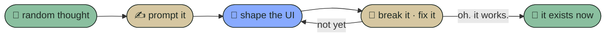

<!-- ───────────────────────────── header ───────────────────────────── -->

<p align="center">
  
</p>

<p align="center">
  
</p>

<p align="center">
  
  
  
  
</p>

<br/>

<!-- ───────────────────────────── about ───────────────────────────── -->

<table align="center">
  <tr>
    <td>

```ts
const eleven = {
  kind:      "friendly being",
  builds:    ["interfaces", "visual ideas", "small tools"],
  with:      ["AI", "curiosity", "too many tabs"],
  approach:  "make it exist first, make it perfect later",
  genius:    false,   // and that's fine
  learning:  true,    // always
};
```

</td>
  </tr>
</table>

<p align="center">
  i'm not trying to act like a genius developer.<br/>
  i'm learning, experimenting, and turning the thoughts that live rent-free in my head<br/>
  into things you can actually click on — <b>one idea at a time.</b>
</p>

<br/>

<!-- ───────────────────────────── what i make ───────────────────────────── -->

## ✦ what i like making

<table>
  <tr>
    <td align="center" width="33%" valign="top">
      <br/>
      
      <br/><br/>
      calm, clean, alive-feeling screens<br/>
      <sub>the kind you don't have to think about</sub>
      <br/><br/>
    </td>
    <td align="center" width="33%" valign="top">
      <br/>
      
      <br/><br/>
      layouts, moods, systems, identities<br/>
      <sub>how a thing <i>feels</i> before what it does</sub>
      <br/><br/>
    </td>
    <td align="center" width="33%" valign="top">
      <br/>
      
      <br/><br/>
      ideas shaped with prompts & code<br/>
      <sub>curiosity as a build tool</sub>
      <br/><br/>
    </td>
  </tr>
</table>

<br/>

<!-- ───────────────────────────── process ───────────────────────────── -->

## ⟡ how an idea becomes real



<br/>

<!-- ───────────────────────────── changelog ───────────────────────────── -->

## ↻ changelog of me

```diff
@@ always in beta @@

+ learning in public
+ shipping small, weird, honest things
+ asking AI better questions every day
+ caring about how things feel, not just how they work

- pretending to know everything
- waiting until i "know enough" to start
- building things nobody (including me) wanted
```

<br/>

<!-- ───────────────────────────── toolbox ───────────────────────────── -->

## ⚒ toolbox

<p align="center">
  
</p>

<p align="center">
  <sub>+ AI as a co-pilot, sketchbook, and very patient teacher</sub>
</p>

<br/>

<!-- ───────────────────────────── activity ───────────────────────────── -->

## ◌ making things, lately

<p align="center">
  
</p>

<br/>

<!-- ───────────────────────────── tiny truth ───────────────────────────── -->

<details>
<summary><b>✧ a tiny truth</b> <sub>(click to open)</sub></summary>
<br/>

> i don't always know exactly how something will work.<br/>
> i just know i want to see if it can exist.

and honestly? that's been enough to start every single project here.

</details>

<details>
<summary><b>✧ on using AI openly</b> <sub>(click to open)</sub></summary>
<br/>

i build with AI, and i say so.<br/>
it doesn't replace the taste, the decisions, or the hours of *"no, not like that"* —<br/>
it just means more of my ideas get to leave my head and become real things.

</details>

<br/>

<!-- ───────────────────────────── footer ───────────────────────────── -->

<p align="center">
  <sub>still learning · still experimenting · still making weird little ideas real</sub>
  <br/><br/>
  
</p>

<p align="center">
  
</p>
